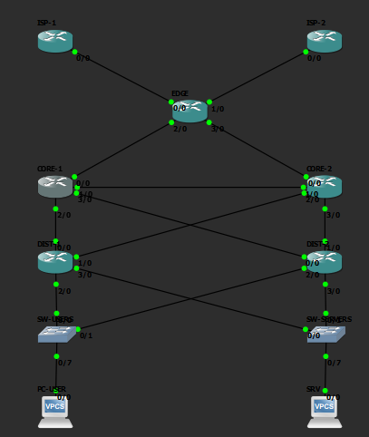

# Memoria del Laboratorio — Failover Routing

**Grupo:** 13 **Materia:** Gestión Operativa y Seguridad en Redes (GOYS) **Fecha de entrega:** viernes 23/10/2026

## Integrantes y roles

> Grupo de **3 personas** repartiendo los 5 roles de la consigna: Persona A cubre R1+R2, Persona B cubre R3+R4, Persona C cubre R5 (ver justificación de la repartición en `README.md`).

| Integrante | Rol |
| :---- | :---- |
| Joaquin Mazza | R1 — Líder / Edge-WAN |
| Joaquin Mazza | R2 — Proveedores |
| Juan Bautista Aramberri | R3 — Core |
| Juan Bautista Aramberri | R4 — Distribución |
| Tomas Costa | R5 — Hosts / QA / Operación |

---

## 1. Diseño (F0)

### 1.1 Corrección del diagrama

Del diagrama "Enterprise Network Design (Cisco)" visto en clase, se corrigen 5 defectos (la consigna pide documentar un mínimo de 3; se incluyen los 5 por completitud):

| # | Defecto detectado | Corrección aplicada | Justificación |
| :---: | :---- | :---- | :---- |
| 1 | Firewall perimetral sin par de alta disponibilidad (SPOF) | El perímetro lo cumple EDGE, multihomed a dos proveedores (ISP-1, ISP-2) por dos sesiones eBGP independientes; se documenta que en producción ese firewall debería ir en par activo/pasivo con sincronización de estado | Eliminar el SPOF del perímetro es prioridad máxima de disponibilidad: por ahí pasa el 100% del tráfico hacia/desde Internet, perderlo es una caída total, no parcial |
| 2 | Subredes solapadas entre sitios | Plan de direccionamiento único y documentado (sección 1.2): cada enlace, LAN y loopback pertenece a un bloque reservado que no se repite en ningún otro punto | El solapamiento rompe el ruteo (rutas ambiguas, resúmenes incorrectos) y es una de las causas más comunes de incidentes reales; resolverlo en F0 evita rehacer direccionamiento después |
| 3 | Sin enlace core-core | Se agrega el enlace CORE-1 ↔ CORE-2, formando malla completa entre core y distribución | El core es la capa de tránsito de toda la organización; sin enlace directo entre sus dos nodos, la falla de un core puede particionar la red en vez de converger por un camino alternativo en milisegundos |
| 4 | HSRP en el core (diseño "collapsed") | El FHRP (VRRP, no HSRP) se mueve a distribución (DIST-1/DIST-2); el core queda como tránsito puro, solo OSPF | Mezclar core y distribución limita la escalabilidad y complica el troubleshooting; separar las capas respeta el modelo jerárquico y permite que cada una se opere de forma independiente |
| 5 | Route Reflector de iBGP mal ubicado | Se usa eBGP puro en el borde (EDGE↔ISP-1, EDGE↔ISP-2), sin Route Reflector; con un único router EDGE no hace falta distribuir rutas iBGP | Agregar un RR donde no hace falta introduce un componente adicional a asegurar y operar sin beneficio real |

### 1.2 Plan de direccionamiento (IPAM)

Principios: espacio privado RFC 1918 (`10.0.0.0/8`) para toda la infraestructura interna; rangos de documentación IANA (RFC 5737: `192.0.2.0/24`, `198.51.100.0/24` y `203.0.113.0/24`) para simular direccionamiento "público" en los enlaces y loopbacks de los ISP, sin usar espacio público real. Cada bloque tiene un propósito único — **cero solapamiento** (verificado programáticamente, ver nota al final de la sección).

| Enlace / Red | Subred | Dispositivo A (IP/iface) | Dispositivo B (IP/iface) |
| :---- | :---: | :---- | :---- |
| ISP-1 ↔ EDGE | 192.0.2.0/30 | ISP-1: 192.0.2.1 | EDGE: 192.0.2.2 |
| ISP-2 ↔ EDGE | 192.0.2.4/30 | ISP-2: 192.0.2.5 | EDGE: 192.0.2.6 |
| EDGE ↔ CORE-1 | 10.0.0.0/30 | EDGE: 10.0.0.1 | CORE-1: 10.0.0.2 |
| EDGE ↔ CORE-2 | 10.0.0.4/30 | EDGE: 10.0.0.5 | CORE-2: 10.0.0.6 |
| CORE-1 ↔ CORE-2 (core-core) | 10.0.0.8/30 | CORE-1: 10.0.0.9 | CORE-2: 10.0.0.10 |
| CORE ↔ DIST-1 (×2) | CORE-1↔DIST-1: 10.0.0.12/30<br>CORE-2↔DIST-1: 10.0.0.20/30 | CORE-1: 10.0.0.13<br>CORE-2: 10.0.0.21 | DIST-1: 10.0.0.14<br>DIST-1: 10.0.0.22 |
| CORE ↔ DIST-2 (×2) | CORE-1↔DIST-2: 10.0.0.16/30<br>CORE-2↔DIST-2: 10.0.0.24/30 | CORE-1: 10.0.0.17<br>CORE-2: 10.0.0.25 | DIST-2: 10.0.0.18<br>DIST-2: 10.0.0.26 |
| USERS (gateway VRRP) | 10.10.10.0/24 | DIST-1: 10.10.10.2 | DIST-2: 10.10.10.3 |
| SERVERS (gateway VRRP) | 10.10.20.0/24 | DIST-1: 10.10.20.2 | DIST-2: 10.10.20.3 |
| Host USERS (PC-USER, VPCS) | 10.10.10.0/24 | PC-USER: 10.10.10.10 | gateway: 10.10.10.1 (VIP vrid 10) |
| Host SERVERS (SRV, VPCS) | 10.10.20.0/24 | SRV: 10.10.20.10 | gateway: 10.10.20.1 (VIP vrid 20) |
| Destino Internet de prueba (drills F4) | 198.51.100.1/32 | ISP-1: loopback | ISP-2: loopback (la misma IP en los dos, no se anuncia por BGP) |

**VRRP:**

| Grupo | VRID | Master | Priority | IP virtual |
| :---- | :---: | :---: | :---: | :---: |
| USERS | 10 | DIST-1 | 150 (DIST-1) / 100 (DIST-2) | 10.10.10.1 |
| SERVERS | 20 | DIST-2 | 150 (DIST-2) / 100 (DIST-1) | 10.10.20.1 |

Load-sharing: DIST-1 es master del grupo 10 y backup del grupo 20; DIST-2 es master del grupo 20 y backup del grupo 10 — así ambos distribución cursan tráfico en operación normal.

**Router-IDs:**

| Nodo | Router-ID |
| :---- | :---- |
| CORE-1 | 10.255.255.1 |
| CORE-2 | 10.255.255.2 |
| EDGE | 10.255.255.3 |
| DIST-1 | 10.255.255.4 |
| DIST-2 | 10.255.255.5 |
| ISP-1 | 203.0.113.1 |
| ISP-2 | 203.0.113.2 |

**Hosts:** cada LAN reserva `.1` para la IP virtual VRRP, `.2`/`.3` para DIST-1/DIST-2 y `.10` en adelante para hosts. Los hosts usan como gateway la IP virtual, nunca la IP real de un DIST, para que el failover sea transparente.

**Gestión de switches (descartado):** en F0 se había reservado `10.10.254.0/24` para gestión fuera de banda de los switches. En el proyecto GNS3 los switches son *Ethernet switch* nativos (no gestionables, sin IP), así que ese bloque queda **sin uso**. Se mantiene reservado para no reasignarlo.

**Verificación de no solapamiento:** los bloques `10.255.255.0/24` (loopbacks), `10.0.0.0/24` (enlaces internos), `10.10.10.0/24` y `10.10.20.0/24` (LANs), `10.10.254.0/24` (reservado, sin uso) y los rangos de documentación `192.0.2.0/24` / `203.0.113.0/24` (enlaces y loopbacks de ISP) son disjuntos entre sí; se verificó con `ipaddress` de Python que ningún par de bloques ni de subredes derivadas se superpone. En F4 se sumó `198.51.100.1/32` (destino de prueba de los drills), de otro bloque de documentación (`198.51.100.0/24`) que no se usa en ningún otro lado; la misma IP en ISP-1 e ISP-2 es a propósito, para que responda el proveedor activo.

### 1.3 Política de seguridad

- **Usuarios y privilegios:** dos cuentas locales por router: `admin` (grupo `full`, contraseña fuerte individual, uso exclusivo para cambios de configuración) y `monitor` (grupo `read`, solo lectura, para consultas/SNMP). Se elimina o renombra cualquier cuenta por defecto sin contraseña. Acceso de gestión (SSH/Winbox) restringido por firewall a la red de gestión del grupo.
- **Servicios que se deshabilitan** (los 7 routers): `telnet`, `ftp`, `www`, `www-ssl` (salvo necesidad puntual), `api`/`api-ssl`, `socks`, `upnp`, `bandwidth-server`, `ddns`, `cloud`, y descubrimiento de vecinos (MNDP/CDP) en interfaces hacia el ISP. Se mantienen `ssh` (único canal de gestión remota) y `winbox` restringido a la red de gestión.
- **Claves de autenticación:**
  - **OSPF** (área 0): MD5, una clave por área, igual en los 5 routers internos (EDGE, CORE-1, CORE-2, DIST-1, DIST-2).
  - **BGP** (eBGP): TCP-MD5 (RFC 2385), una clave distinta por sesión (EDGE↔ISP-1 y EDGE↔ISP-2), nunca reutilizada entre sesiones.
  - **VRRP:** autenticación simple, una clave por grupo (vrid 10 y vrid 20), distinta entre sí.
  - Ninguna clave real se escribe en este documento ni se commitea al repo; se generan y distribuyen por el canal que defina el grupo (gestor de contraseñas compartido) y se rotan si un integrante deja de tener acceso. El drill de seguridad de F4 verifica que una clave incorrecta hace **fallar** la adyacencia/sesión.

### 1.4 Política de operación

- **Formato del change log (convención de commits):** Conventional Commits (`tipo(alcance): descripción breve`, tipos `feat`/`fix`/`docs`/`ops`/`chore`, ver `README.md`). Cada cambio de configuración relevante se registra además en `CHANGELOG.md` con columnas Fecha · Autor (Rol) · Commit · Descripción · Sistemas afectados · Plan de rollback. El change log debe reflejar el historial real de git (una fila por commit o grupo de commits de un mismo cambio lógico), no completarse aparte sin relación con los commits.
- **Política de backup (cuándo y cómo):** se respalda el `/export` completo de cada router. Un snapshot **BASE** apenas cada router queda desplegado (F1), antes de tocar VRRP/OSPF/BGP; un backup antes y después de cada cambio relevante; un backup adicional antes de cada drill (F4). Se guardan en `backups/<router>_<AAAAMMDD>_<fase-o-motivo>.rsc`, sin borrar backups anteriores (retención total durante el laboratorio). Al menos una vez se restaura un backup para confirmar que es válido ("backup probado"), documentando el resultado en F1/F4.

---

## 2. Topología

Proyecto GNS3 `goys-failover-g13` (F1): 11 nodos y 15 enlaces, los 7 routers como VMs de VirtualBox con MikroTik CHR 7.24.5. El diagrama de diseño corregido está en `docs/diagramas/topologia.md`.



Captura del 16/10/2026 en el lab de R5, con los 11 nodos encendidos y los 15 enlaces arriba. La primera captura (`topologia-gns3.png`, 15/10) es de cuando CORE/DIST todavía no estaban levantados.

| Capa | Nodos | Enlaces |
| :---- | :---- | :---- |
| INTERNET | ISP-1 (AS 65001), ISP-2 (AS 65002) | ether1 de cada ISP → EDGE |
| EDGE | EDGE (AS 65000) | ether1 → ISP-1, ether2 → ISP-2, ether3 → CORE-1, ether4 → CORE-2 |
| CORE | CORE-1, CORE-2 | ether1 → EDGE, ether2 → core-core, ether3 → DIST-1, ether4 → DIST-2 |
| DISTRIBUTION | DIST-1, DIST-2 | ether1 → CORE-1, ether2 → CORE-2, ether3 → SW-USERS, ether4 → SW-SERVERS |
| ACCESS | SW-USERS + PC-USER, SW-SERVERS + SRV | switch → host (VPCS) |

En la captura, las etiquetas de GNS3 `0/0`, `1/0`, `2/0`, `3/0` corresponden a `ether1`, `ether2`, `ether3`, `ether4` de cada router.

---

## 3. Configuración

> Un bloque por dispositivo con la config de F1 y F2; el script completo está en `configs/<ROUTER>.rsc`. BGP y el firewall se agregan en F3.

### 3.1 ISP-1

Script completo: [`configs/ISP-1.rsc`](../configs/ISP-1.rsc). Resumen de F1 y F3:

- **IPs:** `ether1` 192.0.2.1/30 → EDGE; `loopback` 203.0.113.1/32 (router-id).
- **Interfaces:** lista `CUSTOMER` con `ether1` (enlace al cliente). `ether2`–`ether4` apagadas (sin uso).
- **Hardening:** telnet, ftp, www, www-ssl, api, api-ssl y reverse-proxy apagados; ssh y winbox solo desde la loopback propia `203.0.113.1/32` (gestión solo por consola de GNS3); socks, upnp, proxy, cloud, DNS remoto y bandwidth-server apagados; sin descubrimiento de vecinos ni MAC server; usuario `monitor` (grupo `read`). Las claves se cargan por consola.
- **BGP (F3):** instancia `bgp-isp1` (AS 65001, router-id 203.0.113.1); sesión eBGP `to-EDGE` con 192.0.2.2 (AS 65000) con TCP-MD5; anuncia su loopback (address-list `bgp-anuncios`) y le manda la ruta por defecto al cliente (`default-originate=always`). La clave TCP-MD5 se carga por consola al activar la sesión, que el script crea deshabilitada.
- **Firewall (F3):** input con solo respuestas, ping y BGP desde EDGE; el UDP se rechaza con port-unreachable para que el traceroute de los hosts llegue al último salto, y el resto se descarta. Ni el cliente ni el otro proveedor llegan a la gestión.
- **Drills (F4):** `to-EDGE` con `hold-time=9s keepalive-time=3s` (post-mortem del drill 3) y `198.51.100.1/32` en la loopback como destino "Internet" de prueba, el mismo en los dos ISP (no se anuncia por BGP).

### 3.2 ISP-2

Script completo: [`configs/ISP-2.rsc`](../configs/ISP-2.rsc). Resumen de F1 y F3:

- **IPs:** `ether1` 192.0.2.5/30 → EDGE; `loopback` 203.0.113.2/32 (router-id).
- **Interfaces:** lista `CUSTOMER` con `ether1` (enlace al cliente). `ether2`–`ether4` apagadas (sin uso).
- **Hardening:** telnet, ftp, www, www-ssl, api, api-ssl y reverse-proxy apagados; ssh y winbox solo desde la loopback propia `203.0.113.2/32` (gestión solo por consola de GNS3); socks, upnp, proxy, cloud, DNS remoto y bandwidth-server apagados; sin descubrimiento de vecinos ni MAC server; usuario `monitor` (grupo `read`). Las claves se cargan por consola.
- **BGP (F3):** igual que ISP-1 con sus datos: instancia `bgp-isp2` (AS 65002, router-id 203.0.113.2), sesión `to-EDGE` con 192.0.2.6 con TCP-MD5 (clave distinta de la de ISP-1), anuncia 203.0.113.2/32 y la ruta por defecto.
- **Firewall (F3):** input con solo respuestas, ping y BGP desde EDGE; el UDP se rechaza con port-unreachable para que el traceroute de los hosts llegue al último salto, y el resto se descarta. Ni el cliente ni el otro proveedor llegan a la gestión.
- **Drills (F4):** igual que ISP-1: `to-EDGE` con `hold-time=9s keepalive-time=3s` y `198.51.100.1/32` en la loopback.

### 3.3 EDGE

Script completo: [`configs/EDGE.rsc`](../configs/EDGE.rsc). Resumen de F1 y F2:

- **IPs:** `ether1` 192.0.2.2/30 → ISP-1; `ether2` 192.0.2.6/30 → ISP-2; `ether3` 10.0.0.1/30 → CORE-1; `ether4` 10.0.0.5/30 → CORE-2; `loopback` 10.255.255.3/32 (router-id).
- **Interfaces:** lista `WAN` (`ether1`, `ether2`, enlaces a los proveedores) y lista `LAN` (`ether3`, `ether4` y loopback), para el firewall de F3.
- **Hardening:** telnet, ftp, www, www-ssl, api, api-ssl y reverse-proxy apagados; ssh y winbox solo desde `10.0.0.0/24` y `10.255.255.0/24`; socks, upnp, proxy, cloud, DNS remoto y bandwidth-server apagados; descubrimiento de vecinos y MAC server solo en `LAN`; usuario `monitor` (grupo `read`). Las claves se cargan por consola.
- **OSPF (F2):** instancia `ospf-v2` (router-id 10.255.255.3), área `backbone` 0.0.0.0; `ether3` y `ether4` hacia CORE-1/CORE-2 como `ptp` con MD5 (`auth-id=1`, plantilla `ospf-transito`); loopback pasiva. Hacia los ISP no corre OSPF (eBGP en F3). La clave MD5 se carga por consola al activar la plantilla de tránsito, que el script crea deshabilitada.
- **BGP (F3):** instancia `bgp-edge` (AS 65000, router-id 10.255.255.3); sesiones eBGP `to-ISP-1` (192.0.2.1, AS 65001) y `to-ISP-2` (192.0.2.5, AS 65002) con TCP-MD5, una clave distinta por sesión. Redistribuye OSPF → BGP con el filtro de salida `bgp-out-isp`, que deja pasar solo 10.10.10.0/24 y 10.10.20.0/24 (no hay tránsito entre ISPs); el filtro de entrada `bgp-in-isp` acepta solo la ruta por defecto y las loopbacks de los ISP. La default aprendida por BGP se propaga al resto de la red por OSPF (`originate-default=if-installed`). Las claves se cargan por consola al activar las sesiones, que el script crea deshabilitadas.
- **Firewall (F3):** input: respuestas, ping, BGP solo desde los ISP (address-list `bgp-peers`), OSPF y descubrimiento de vecinos solo por `LAN`, ssh/winbox solo desde la address-list `gestion` (`10.0.0.0/24`, `10.255.255.0/24`); el resto se descarta. Forward: las LANs salen, desde `WAN` solo entran respuestas. Antispoofing en `raw`: se descarta todo lo que llega de `WAN` con origen en `10.0.0.0/8`.
- **Drills (F4):** `to-ISP-1` y `to-ISP-2` con `hold-time=9s keepalive-time=3s`: con los timers por defecto el cambio de proveedor tardaba 164 s y con estos, 8 s (drill 3, sección 4.2). Las estáticas con `check-gateway` del drill 4 fueron temporales y no quedan en la configuración.

### 3.4 CORE-1

Script completo: [`configs/CORE-1.rsc`](../configs/CORE-1.rsc). Resumen de F1, F2 y F3:

- **IPs:** `ether1` 10.0.0.2/30 → EDGE; `ether2` 10.0.0.9/30 → CORE-2 (core-core); `ether3` 10.0.0.13/30 → DIST-1; `ether4` 10.0.0.17/30 → DIST-2; `loopback` 10.255.255.1/32 (router-id).
- **Interfaces:** lista `LAN` con los 4 enlaces y la loopback.
- **Hardening:** telnet, ftp, www, www-ssl, api, api-ssl y reverse-proxy apagados; ssh y winbox solo desde `10.0.0.0/24` y `10.255.255.0/24`; socks, upnp, proxy, cloud, DNS remoto y bandwidth-server apagados; descubrimiento de vecinos y MAC server solo en `LAN`; usuario `monitor` (grupo `read`). Las claves se cargan por consola.
- **OSPF (F2):** instancia `ospf-v2`, router-id = loopback, área `backbone` 0.0.0.0. Plantilla `ospf-transito` en `ether1`–`ether4` (`type=ptp`, MD5 con `auth-id=1`) y loopback pasiva. La clave MD5 se carga por consola.
- **Firewall (F3):** input con respuestas, ping, OSPF y descubrimiento de vecinos solo por `LAN`, y ssh/winbox solo desde la address-list `gestion` (`10.0.0.0/24`, `10.255.255.0/24`); el resto se descarta. Sin filtro de forward: CORE es tránsito puro.

### 3.5 CORE-2

Script completo: [`configs/CORE-2.rsc`](../configs/CORE-2.rsc). Resumen de F1, F2 y F3:

- **IPs:** `ether1` 10.0.0.6/30 → EDGE; `ether2` 10.0.0.10/30 → CORE-1 (core-core); `ether3` 10.0.0.21/30 → DIST-1; `ether4` 10.0.0.25/30 → DIST-2; `loopback` 10.255.255.2/32 (router-id).
- **Interfaces:** lista `LAN` con los 4 enlaces y la loopback.
- **Hardening:** telnet, ftp, www, www-ssl, api, api-ssl y reverse-proxy apagados; ssh y winbox solo desde `10.0.0.0/24` y `10.255.255.0/24`; socks, upnp, proxy, cloud, DNS remoto y bandwidth-server apagados; descubrimiento de vecinos y MAC server solo en `LAN`; usuario `monitor` (grupo `read`). Las claves se cargan por consola.
- **OSPF (F2):** instancia `ospf-v2`, router-id = loopback, área `backbone` 0.0.0.0. Plantilla `ospf-transito` en `ether1`–`ether4` (`type=ptp`, MD5 con `auth-id=1`) y loopback pasiva. La clave MD5 se carga por consola.
- **Firewall (F3):** input con respuestas, ping, OSPF y descubrimiento de vecinos solo por `LAN`, y ssh/winbox solo desde la address-list `gestion` (`10.0.0.0/24`, `10.255.255.0/24`); el resto se descarta. Sin filtro de forward: CORE es tránsito puro.

### 3.6 DIST-1

Script completo: [`configs/DIST-1.rsc`](../configs/DIST-1.rsc). Resumen de F1, F2 y F3:

- **IPs:** `ether1` 10.0.0.14/30 → CORE-1; `ether2` 10.0.0.22/30 → CORE-2; `ether3` 10.10.10.2/24 → LAN USERS; `ether4` 10.10.20.2/24 → LAN SERVERS; `loopback` 10.255.255.4/32 (router-id).
- **Interfaces:** lista `LAN` (enlaces a los CORE y loopback) y lista `ACCESS` (LANs USERS y SERVERS). Las IPs de las LANs son las físicas; la VIP de VRRP se agrega en F2.
- **Hardening:** telnet, ftp, www, www-ssl, api, api-ssl y reverse-proxy apagados; ssh y winbox solo desde `10.0.0.0/24` y `10.255.255.0/24`; socks, upnp, proxy, cloud, DNS remoto y bandwidth-server apagados; descubrimiento de vecinos y MAC server solo en `LAN`; usuario `monitor` (grupo `read`). Las claves se cargan por consola.
- **OSPF (F2):** instancia `ospf-v2`, router-id = loopback, área `backbone` 0.0.0.0. Plantilla `ospf-transito` en `ether1`–`ether2` (`type=ptp`, MD5 con `auth-id=1`); loopback y LANs (`ether3`, `ether4`) pasivas. La clave MD5 se carga por consola.
- **VRRP (F2):** `vrrp10` en `ether3` (priority 150, master) y `vrrp20` en `ether4` (priority 100, backup), versión 2 con auth simple, una clave por grupo cargada por consola. VIPs 10.10.10.1/32 y 10.10.20.1/32.
- **Firewall (F3):** input con respuestas, ping, OSPF y descubrimiento de vecinos solo por `LAN` (enlaces a los CORE), VRRP solo por `ACCESS` (LANs; sin esto los dos DIST quedan master), y ssh/winbox solo desde la address-list `gestion`; el resto se descarta, así que desde las LANs solo se llega al ping del gateway.

### 3.7 DIST-2

Script completo: [`configs/DIST-2.rsc`](../configs/DIST-2.rsc). Resumen de F1, F2 y F3:

- **IPs:** `ether1` 10.0.0.18/30 → CORE-1; `ether2` 10.0.0.26/30 → CORE-2; `ether3` 10.10.10.3/24 → LAN USERS; `ether4` 10.10.20.3/24 → LAN SERVERS; `loopback` 10.255.255.5/32 (router-id).
- **Interfaces:** lista `LAN` (enlaces a los CORE y loopback) y lista `ACCESS` (LANs USERS y SERVERS). Las IPs de las LANs son las físicas; la VIP de VRRP se agrega en F2.
- **Hardening:** telnet, ftp, www, www-ssl, api, api-ssl y reverse-proxy apagados; ssh y winbox solo desde `10.0.0.0/24` y `10.255.255.0/24`; socks, upnp, proxy, cloud, DNS remoto y bandwidth-server apagados; descubrimiento de vecinos y MAC server solo en `LAN`; usuario `monitor` (grupo `read`). Las claves se cargan por consola.
- **OSPF (F2):** instancia `ospf-v2`, router-id = loopback, área `backbone` 0.0.0.0. Plantilla `ospf-transito` en `ether1`–`ether2` (`type=ptp`, MD5 con `auth-id=1`); loopback y LANs (`ether3`, `ether4`) pasivas. La clave MD5 se carga por consola.
- **VRRP (F2):** `vrrp10` en `ether3` (priority 100, backup) y `vrrp20` en `ether4` (priority 150, master), versión 2 con auth simple, una clave por grupo cargada por consola. VIPs 10.10.10.1/32 y 10.10.20.1/32.
- **Firewall (F3):** input con respuestas, ping, OSPF y descubrimiento de vecinos solo por `LAN` (enlaces a los CORE), VRRP solo por `ACCESS` (LANs; sin esto los dos DIST quedan master), y ssh/winbox solo desde la address-list `gestion`; el resto se descarta, así que desde las LANs solo se llega al ping del gateway.

### 3.8 Hosts (PC-USER / SRV)

Hosts VPCS de GNS3. Config versionada en `configs/PC-USER.vpc` y `configs/SRV.vpc`, idéntica al `startup.vpc` que genera `save` en el proyecto:

```sh
# configs/PC-USER.vpc (LAN USERS)
set pcname PC-USER
ip 10.10.10.10 10.10.10.1 24

# configs/SRV.vpc (LAN SERVERS)
set pcname SRV
ip 10.10.20.10 10.10.20.1 24
```

Para cargarla a mano en la consola del VPCS se puede tipear lo mismo, o la forma equivalente `ip 10.10.10.10/24 10.10.10.1`, y después `save` para que persista.

Verificación: `show ip` en cada host (capturas `capturas/f1/pc-user-ip.png` y `srv-ip.png`, 16/10/2026, R5). El ping al gateway (`ping 10.10.10.1` / `ping 10.10.20.1`) recién responde cuando VRRP esté activo en DIST-1/DIST-2 (F2).

---

## 4. Verificación

> **Pendiente de F1/F2/F3** (requiere los equipos desplegados y configurados).

### 4.1 Conectividad básica

| Prueba | Comando | Resultado |
| :---- | :---- | :---- |
| ping EDGE → ISP-1 (vecino directo, F1) | en EDGE: `/ping 192.0.2.1 count=3` | OK, 3/3, 0% de pérdida — `capturas/f1/edge-ips-y-pings.png` |
| ping EDGE → ISP-2 (vecino directo, F1) | en EDGE: `/ping 192.0.2.5 count=3` | OK, 3/3, 0% de pérdida — `capturas/f1/edge-ips-y-pings.png` |
| ping ISP-1 → EDGE (vecino directo, F1) | en ISP-1: `/ping 192.0.2.2 count=3` | OK, 3/3, 0% de pérdida — `capturas/f1/isp1-isp2-ips-y-pings.png` |
| ping ISP-2 → EDGE (vecino directo, F1) | en ISP-2: `/ping 192.0.2.6 count=3` | OK, 3/3, 0% de pérdida — `capturas/f1/isp1-isp2-ips-y-pings.png` |
| Verificación independiente de R5 (F1) | `/ip address print` + ping al vecino en EDGE, ISP-1 e ISP-2 | OK — `capturas/f1/edge-ips-ping.png`, `isp1-ips-ping.png`, `isp2-ips-ping.png` |
| ping EDGE → CORE-1 / CORE-2 (vecinos directos, F1) | en EDGE: `/ping 10.0.0.2` y `/ping 10.0.0.6` | OK — `capturas/f1/edge-core-pings.png` (R3/R4) |
| ping entre vecinos de CORE y DIST (core-core, core-dist y dist-dist por las dos LANs, F1) | `/ping` a cada vecino directo desde CORE-1, CORE-2, DIST-1 y DIST-2 | OK — `capturas/f1/core1-pings.png`, `core2-pings.png`, `dist1-pings.png`, `dist2-pings.png` (R3/R4) |
| Verificación independiente de R5 (F1) | `/ip address print` + ping a cada vecino directo en CORE-1, CORE-2, DIST-1 y DIST-2 (los DIST también entre sí por las dos LAN) | OK, 3/3 en todos — `capturas/f1/core1-ips-ping.png`, `core2-ips-ping.png`, `dist1-ips-ping.png`, `dist2-ips-ping.png` |
| Adyacencias OSPF de EDGE con MD5 (F2) | en EDGE: `/routing ospf neighbor print` y `/ip route print where ospf`; en EDGE y CORE-1: `/routing ospf interface-template print` | OK — CORE-1 (10.255.255.1) y CORE-2 (10.255.255.2) en `Full`; loopbacks y enlaces internos aprendidos por OSPF (distancia 110), con ECMP hacia el core-core — `capturas/f2/edge-ospf-vecinos.png`. La plantilla `ospf-transito` tiene `auth=md5 auth-id=1` en las dos puntas del enlace (la clave no se muestra) — `capturas/f2/edge-ospf-md5.png`, `core1-ospf-md5.png` (R1) |
| ping entre loopbacks por OSPF (F2) | en EDGE: `/ping 10.255.255.1 src-address=10.255.255.3` y `/ping 10.255.255.2 src-address=10.255.255.3` | OK, 3/3, 0% de pérdida en los dos — `capturas/f2/edge-ping-loopbacks.png` (R1) |
| Adyacencias OSPF de CORE y DIST con MD5 (F2) | en CORE-1, CORE-2, DIST-1 y DIST-2: `/routing ospf neighbor print` y `/ip route print where ospf`; en CORE-1: `/routing ospf interface-template print` | OK — core-core y los cuatro enlaces core-dist en `Full`; loopbacks, enlaces internos y las dos LANs aprendidos por OSPF (distancia 110), con ECMP hacia las LANs por los dos DIST. `ospf-transito` con `auth=md5 auth-id=1` (la clave no se muestra) — `capturas/f2/core1-ospf.png`, `core2-ospf.png`, `dist1-ospf-vrrp.png`, `dist2-ospf-vrrp.png`, `ospf-md5.png` (R3/R4) |
| Adyacencias OSPF con la topología completa (F2) | en CORE-1: `/routing ospf neighbor print`; en EDGE: `/ip route print where ospf` | OK — en un mismo lab, CORE-1 con sus 4 vecinos en `Full`: EDGE (10.255.255.3), CORE-2, DIST-1 y DIST-2. EDGE aprende las loopbacks de los DIST y las dos LANs por ECMP vía los dos CORE — `capturas/f2/core1-ospf-vecinos.png`, `edge-ospf-rutas.png` (R3/R4) |
| VRRP master/backup (F2) | en DIST-1 y DIST-2: `/interface vrrp print` | OK — DIST-1 master de vrid 10 (priority 150) y backup de vrid 20 (100); DIST-2 al revés: load-sharing de la memoria 1.2 — `capturas/f2/dist1-ospf-vrrp.png`, `dist2-ospf-vrrp.png` (R4) |
| Gateway virtual desde los hosts (F2) | en PC-USER: `ping 10.10.10.1`; en SRV: `ping 10.10.20.1` | OK, 5/5 en los dos — `capturas/f2/pc-user-ping.png`, `srv-ping.png` (R3/R4) |
| Plano de gestión de CORE y DIST (F3) | en CORE-1 y DIST-1: `/ip firewall filter print stats`; en PC-USER: `ping 10.10.10.1`, `ping 10.10.20.10`, `ping 10.10.10.2 -P 6 -p 22` y `-p 8291` | OK — con el firewall de input aplicado siguen OSPF en `Full` y VRRP con un master por grupo (suman los accept de OSPF y VRRP); los hosts llegan al gateway virtual y a la otra LAN, y ssh (22) y winbox (8291) hacia el DIST desde la LAN dan timeout (suma el drop final) — `capturas/f3/core1-firewall.png`, `dist1-firewall.png`, `pc-user-gestion-bloqueada.png` (R3/R4) |
| ping intra-LAN (PC-USER ↔ SRV) (F2) | en PC-USER: `ping 10.10.20.10` y `trace 10.10.20.10` | OK — 3/5: los dos primeros timeouts son la resolución ARP de VPCS; el trace pasa por 10.10.10.2 (DIST-1, master de USERS) y llega a SRV — `capturas/f2/pc-user-ping.png` (R3/R4) |
| Sesiones eBGP de EDGE con TCP-MD5 (F3) | en EDGE: `/routing bgp session print` | OK — `to-ISP-1` (AS 65001) y `to-ISP-2` (AS 65002) en `E` (established), cada una con su filtro de entrada `bgp-in-isp` y de salida `bgp-out-isp` — `capturas/f3/edge-bgp-sesiones.png` (R1) |
| Rutas BGP en EDGE (F3) | en EDGE: `/ip route print where bgp or dst-address in 10.10.0.0/16` | OK — default de los dos ISP (activa la de ISP-1) y sus loopbacks 203.0.113.1/32 y 203.0.113.2/32 por BGP; las LANs 10.10.10.0/24 y 10.10.20.0/24 por OSPF vía los dos CORE — `capturas/f3/edge-bgp-rutas.png` (R1) |
| Anuncio de las LANs a los ISP (F3) | en ISP-1 e ISP-2: `/ip route print where bgp` | OK — cada ISP aprende de EDGE solo 10.10.10.0/24 y 10.10.20.0/24: ni enlaces internos ni loopbacks (el filtro de salida funciona) — `capturas/f3/isp1-bgp-rutas.png`, `isp2-bgp-rutas.png` (R1/R2) |
| Firewall del EDGE: tráfico permitido y bloqueado (F3) | desde ISP-1: `/ping 10.10.10.2`, `/ping 192.0.2.2` y `/tool fetch url="http://192.0.2.2:22/"`; en EDGE: `/ip firewall filter print stats` | OK — desde ISP-1 la LAN no responde (100% de pérdida, la cuenta la regla `forward: nada nuevo desde los ISP`), el ping al EDGE sí, y la conexión al puerto 22 del EDGE falla por timeout (la cuenta `input: todo lo demas`). Con el firewall puesto, las dos sesiones BGP siguen `established` y OSPF sigue en `Full` — `capturas/f3/isp1-firewall-pruebas.png`, `edge-firewall-input.png`, `edge-firewall-forward.png` (R1) |
| Verificación independiente de R5 (F2) | en CORE-1 y CORE-2: `/routing ospf neighbor print`; en DIST-1 y DIST-2: `/interface vrrp print`; en PC-USER y SRV: `show ip`, ping a la VIP y al otro host, y `trace` al otro host | OK (29/10, lab de R5 con F2 a F4 cargados desde `configs/`) — CORE-1 y CORE-2 con sus 4 vecinos en `Full` (EDGE, el otro CORE y los dos DIST); DIST-1 master del vrid 10 y backup del 20, DIST-2 al revés; ping a la VIP 5/5 y 4/4; entre hosts 3/5, con los dos primeros timeouts de ARP de VPCS; el trace sale por el master de cada LAN (10.10.10.2 desde PC-USER, 10.10.20.3 desde SRV) — `capturas/f2/core1-ospf-vecinos-r5.png`, `core2-ospf-vecinos-r5.png`, `dist1-vrrp-r5.png`, `dist2-vrrp-r5.png`, `pc-user-ping-r5.png`, `srv-ping-r5.png` |
| Verificación independiente de R5 (F3) | en EDGE: `/ip route print where bgp` | OK (29/10, lab de R5) — default de los dos ISP (activa la de ISP-1) y las loopbacks 203.0.113.1/32 y 203.0.113.2/32, igual que en el lab de R1 — `capturas/f3/edge-bgp-rutas-r5.png` |
| traceroute a ISP (loopback) (F3) | en PC-USER: `ping 203.0.113.1`, `trace 203.0.113.1` y `trace 203.0.113.2`; en SRV: `ping 203.0.113.2` y `trace 203.0.113.2` | OK (29/10, R5) — ping 5/5 y 4/4. Los tres trace llegan al cuarto salto con `Destination port unreachable` (el UDP rechazado de `87f26c9`): desde PC-USER, DIST-1 (10.10.10.2) → CORE-1 (10.0.0.13) → EDGE (10.0.0.1) → ISP; desde SRV, DIST-2 (10.10.20.3) → CORE-2 (10.0.0.25) → EDGE (10.0.0.5) → ISP-2. Cada LAN sale por su master VRRP y EDGE elige el ISP según la ruta BGP de cada loopback — `capturas/f3/pc-user-trace-isp-r5.png`, `srv-trace-isp-r5.png` |

> Pegar capturas de las tablas: `/routing/route/print`, `/interface/vrrp/print`, `/routing/bgp/session/print`.

### 4.2 Los 5 drills de failover

Cada drill se documenta con la estructura detección → respuesta → recuperación → post-mortem y el tiempo medido. El procedimiento para repetirlo (estado previo, comandos, medición, limpieza e historial de corridas) está en su runbook, armado con la plantilla [`runbooks/plantilla.md`](../runbooks/plantilla.md).

#### Drill 1 — VRRP: se cae el gateway

Runbook: [`runbooks/drill-1-vrrp.md`](../runbooks/drill-1-vrrp.md).

Operó R3/R4 (28/10). Falla simulada: en DIST-1, master del vrid 10, `/interface ethernet disable ether3` (el puerto de la LAN USERS). Medición: desde PC-USER, `ping 10.10.20.10 -c 25` (1 por segundo hacia SRV, que sale por el gateway virtual 10.10.10.1); la falla se provoca en el ping 5 y la recuperación en el 15, dentro del mismo ping.

- **Detección:** DIST-2 deja de recibir los anuncios VRRP de DIST-1 en la LAN USERS. Al vencer el *master down interval* (3 × 1 s + skew de 0,61 s con prioridad 100) pasa a master: `vrrp10 now MASTER, master down timer` en `/log print where message~"vrrp10"`.
- **Respuesta:** automática. DIST-2 toma la IP virtual 10.10.10.1 con la misma MAC virtual (`00:00:5E:00:01:0A`) y manda ARP gratuito, así que PC-USER no cambia nada: sigue usando el mismo gateway. Hacia adentro, DIST-1 deja de anunciar 10.10.10.0/24 por OSPF y la vuelta entra por DIST-2.
- **Recuperación:** en DIST-1 `/interface ethernet enable ether3`. Con `preemption-mode=yes` y prioridad 150, DIST-1 recupera el master y DIST-2 vuelve a backup (`now BACKUP, got higher priority 150 from 10.10.10.2`), sin pérdida de pings.
- **Tiempo medido:** **~2 s** sin salida (pings 6 y 7 perdidos de 25) y 0 en la vuelta — `capturas/f4/pc-user-drill1-ping.png`, `dist2-drill1-vrrp.png`. En una primera corrida (40 pings, sin captura del ping) se perdieron 4: la diferencia depende de en qué momento del intervalo de anuncios cae la falla.
- **Post-mortem:** funcionó porque el gateway de los hosts es una IP virtual y no la de un router: el cambio de master es invisible para PC-USER. El tiempo queda por debajo del teórico de VRRP con `interval=1s` (≈3,6 s como máximo). Se podría bajar el intervalo, pero con 2 a 4 s el corte ya es menor que el de los protocolos de arriba y un intervalo más corto hace más probable un doble master por pérdida de anuncios. Lo que no cubre VRRP es que el master pierda los uplinks y no la LAN: eso se vio en la prueba de clave incorrecta (sección 5).

#### Drill 2 — OSPF: se corta el camino interno

Runbook: [`runbooks/drill-2-ospf.md`](../runbooks/drill-2-ospf.md).

Operó R3/R4 (28/10). Antes de la falla, DIST-1 llega a la loopback de EDGE (10.255.255.3) por ECMP vía CORE-1 y CORE-2, y el `trace` desde PC-USER sale por CORE-1. Falla simulada: en CORE-1 `/interface ethernet disable ether3` (enlace CORE1–DIST1, 10.0.0.12/30). Se corta del lado de CORE-1 a propósito: para DIST-1 el enlace sigue arriba, como cuando se cae el equipo de la otra punta y no el cable. Medición: desde PC-USER, `trace 10.255.255.3` antes y después de la falla y `ping 10.255.255.3 -c 20`; la falla se provoca en el ping 5.

- **Detección:** CORE-1 ve caer su interfaz al instante y genera un LSA nuevo sin el enlace a DIST-1, que llega a DIST-1 por CORE-2. DIST-1 no esperó el *dead interval*: en el SPF el enlace a CORE-1 deja de ser bidireccional y lo descarta. El vecino recién cae por `timeout` unos 35 s después (`/log print where message~"timeout"`).
- **Respuesta:** automática. En DIST-1, `/ip route print where dst-address=10.255.255.3/32` pasa de dos caminos a uno solo por CORE-2 (10.0.0.21), y el `trace` desde PC-USER cambia el salto 2 de CORE-1 (`10.0.0.17`, la IP con la que CORE-1 responde) a CORE-2 (`10.0.0.21`).
- **Recuperación:** en CORE-1 `/interface ethernet enable ether3`. La adyacencia vuelve a `Full` y DIST-1 recupera los dos caminos, sin pérdida de pings.
- **Tiempo medido:** **~1 s** sin salida (ping 6 perdido de 20) y 0 de 20 en la vuelta, igual que en una primera corrida (1 de 75) — `capturas/f4/pc-user-drill2-ping.png` (traces y ping), `dist1-drill2-ruta.png` (un solo camino durante la falla), `dist1-drill2-ospf.png`.
- **Post-mortem:** funcionó porque cada DIST tiene dos caminos al core y OSPF ya los tenía calculados. Corrió rápido porque uno de los dos extremos vio caer el enlace. Si ninguno de los dos lo ve (por ejemplo, un switch en el medio que deja de pasar tráfico), la detección depende del *dead interval* de 40 s: con un enlace real convendría BFD o bajar `hello-interval`/`dead-interval` en `ospf-transito`.

#### Drill 3 — BGP: se cae el proveedor

Runbook: [`runbooks/drill-3-bgp.md`](../runbooks/drill-3-bgp.md).

Operó R1/R2 (28/10). Falla simulada: en ISP-1 `/interface disable ether1`, del lado del proveedor, así el enlace del EDGE sigue arriba (como cuando se cae el ISP y no el cable). Medición: desde DIST-1, `/ping 198.51.100.1 src-address=10.10.10.2 interval=1s`; `198.51.100.1` es un destino de prueba que tienen los dos ISP en su loopback, así responde el que esté activo. Antes de la falla la default activa en EDGE es la de ISP-1 (las dos tienen distancia 20 y queda la primera que se aprendió).

- **Detección:** EDGE no ve caer el enlace, solo deja de recibir keepalives de ISP-1. La detecta al vencer el hold-time: `HoldTimer expired to-ISP-1` en `/log print where topics~"bgp"`; la sesión pasa a `Idle` y `/routing bgp session print` muestra solo `to-ISP-2` en `E`.
- **Respuesta:** automática. EDGE retira la default y las rutas aprendidas de ISP-1 y queda activa la default de ISP-2 (`/ip route print where dst-address=0.0.0.0/0`). Como la default entra a OSPF con `originate-default=if-installed`, el resto de la red no cambia nada: sigue mandando todo al EDGE. Hacia adentro, ISP-2 ya tenía las dos LANs por BGP, así que la vuelta no depende de ISP-1.
- **Recuperación:** en ISP-1 `/interface enable ether1`. La sesión vuelve a `E` en 8 s y la default de ISP-1 vuelve a quedar disponible.
- **Tiempo medido:**
  - Con los timers por defecto (hold-time 3m, keepalive 1m): **164 s** sin salida (pings 14 a 177 perdidos de 260) — `capturas/f4/edge-drill3-holdtimer.png`, `dist1-drill3-ping-1.png`.
  - Con hold-time 9s y keepalive 3s en las dos puntas: **8 s** (pings 13 a 20 perdidos de 60) — `capturas/f4/edge-drill3-holdtimer-9s.png`, `dist1-drill3-ping-2.png`.
- **Post-mortem:** el failover funcionó porque las dos sesiones están siempre arriba y EDGE ya tiene la default de ISP-2 cargada, pero con los timers por defecto el corte dura casi lo mismo que el hold-time: cuando falla el proveedor y no el enlace, BGP no tiene otra forma de enterarse. Se bajaron los timers a 9s/3s en las conexiones de EDGE, ISP-1 e ISP-2 (`configs/*.rsc`, bloque F4). El costo es un keepalive cada 3 s por sesión, despreciable, y una sesión más sensible a pérdidas en el enlace (se cae si se pierden 3 keepalives seguidos). Con un enlace real la alternativa sería BFD, que detecta en menos de un segundo.

#### Drill 4 — check-gateway: failover estático de enlace

Runbook: [`runbooks/drill-4-check-gateway.md`](../runbooks/drill-4-check-gateway.md).

Operó R1 (28/10). Para el drill se agregaron en EDGE dos defaults estáticas temporales con `check-gateway=ping`: `gateway=192.0.2.1 distance=1` (ISP-1) y `gateway=192.0.2.5 distance=2` (ISP-2). Al tener menor distancia que las de BGP (20) son las que se usan, así se mide solo el check-gateway. Misma falla y misma medición que en el drill 3.

- **Detección:** EDGE le hace ping al gateway de cada ruta cada 10 s. Cuando ISP-1 deja de responder, la estática por ISP-1 pasa a `I` (inactiva) en `/ip route print where dst-address=0.0.0.0/0`.
- **Respuesta:** automática. Queda activa la estática por ISP-2 (`As`, distancia 2).
- **Recuperación:** en ISP-1 `/interface enable ether1`; la estática por ISP-1 vuelve a quedar activa en 13 s (primer ping del check-gateway que contesta). Al terminar el drill se borraron las dos estáticas (`/ip route remove [ find comment~"drill4" ]`) y quedó la default por BGP como antes.
- **Tiempo medido:** **29 s** sin salida (pings 12 a 40 perdidos de 60) — `capturas/f4/edge-drill4-check-gateway.png`, `dist1-drill4-ping.png`.
- **Post-mortem:** el check-gateway sirve cuando no hay protocolo de ruteo con el proveedor, pero acá es más lento que BGP con los timers ajustados (29 s contra 8 s) y además solo prueba que el gateway responde: si ISP-1 contesta el ping pero pierde la sesión BGP (por ejemplo, una clave mal cargada), la estática sigue activa, el tráfico sale por ISP-1 y la vuelta no llega porque ISP-1 ya no conoce las LANs. Por eso en el diseño final no quedan estáticas: el failover de proveedor lo hace BGP, que ve las dos cosas (que el ISP está vivo y qué rutas tiene).

#### Drill 5 — Load-sharing VRRP: ambos DIST activos

Runbook: [`runbooks/drill-5-load-sharing.md`](../runbooks/drill-5-load-sharing.md).

Operó R3/R4 (28/10). Estado normal: DIST-1 es master del vrid 10 (USERS, prioridad 150) y DIST-2 del vrid 20 (SERVERS, prioridad 150), así que los dos DIST mueven tráfico. El `trace` lo confirma: desde PC-USER el primer salto es 10.10.10.2 (DIST-1) y desde SRV es 10.10.20.3 (DIST-2). Falla simulada: en DIST-2 `/interface ethernet disable ether3,ether4` (pierde las dos LANs). Medición: desde SRV, `ping 10.10.10.10 -c 25`; la falla se provoca en el ping 5 y la recuperación en el 15, dentro del mismo ping.

- **Detección:** DIST-1 deja de recibir los anuncios del vrid 20 y pasa a master por *master down timer* (`/log print where message~"vrrp20"`).
- **Respuesta:** automática. DIST-1 queda master de los dos grupos (`/interface vrrp print`: `RM` en vrrp10 y vrrp20) y el `trace` desde SRV pasa a salir por 10.10.20.2.
- **Recuperación:** en DIST-2 `/interface ethernet enable ether3,ether4`. DIST-2 recupera el vrid 20 por preemption (`vrrp20 now BACKUP, got higher priority 150 from 10.10.20.3` en DIST-1) y el reparto vuelve a quedar como al principio, sin pérdida de pings. Corte medido: 2 pings perdidos de 25 en la caída (pings 6 y 7) y 0 en la vuelta — `capturas/f4/srv-drill5-ping.png` (trace por 10.10.20.3 y ping), `dist1-drill5-vrrp.png`.
- **Post-mortem:** el reparto funciona porque cada grupo tiene un master distinto con prioridades cruzadas, y cada DIST es backup del otro: cuando cae uno, el otro absorbe todo y se vuelve al reparto solo con la preemption. El costo es que un DIST tiene que poder con el tráfico de las dos LANs mientras dure la falla. Igual que en el drill 1, las prioridades son fijas: VRRP no se entera si el master pierde los uplinks.

---

## 5. Seguridad aplicada

> **Pendiente de F2/F3/F4** (la política está definida en 1.3; esto documenta la verificación real una vez aplicada).

| Mecanismo | Dónde se aplicó | Verificación (¿cómo probaron que funciona?) |
| :---- | :---- | :---- |
| Hardening (usuarios/servicios) | Los 7 routers (F1): EDGE, ISP-1, ISP-2 (R1/R2) y CORE-1, CORE-2, DIST-1, DIST-2 (R3/R4) | `/user print` y `/ip service print` en cada router; login como `monitor` e intento de cambiar la identidad → `not enough permissions` (en CORE/DIST, prueba de R5); en CORE/DIST, además `/tool bandwidth-server print` → `enabled: no`. Capturas en `capturas/f1/` |
| Plano de gestión (CORE/DIST) | CORE-1, CORE-2, DIST-1 y DIST-2 (F3): firewall de input con address-list `gestion` y listas `LAN`/`ACCESS`, misma convención que EDGE | Desde PC-USER, ssh y winbox al DIST (por la IP de la LAN y por la loopback) no conectan y suma el drop final de `input`; ping al gateway y tráfico entre LANs siguen andando, igual que OSPF y VRRP — `capturas/f3/dist1-firewall.png`, `core1-firewall.png`, `pc-user-gestion-bloqueada.png` |
| OSPF MD5 | Área 0 en EDGE, CORE-1, CORE-2, DIST-1 y DIST-2 (F2): plantilla `ospf-transito`, `auth=md5 auth-id=1`, una sola clave para el área | `/routing ospf interface-template print` muestra `auth=md5 auth-id=1` sin la clave, y las adyacencias quedan en `Full` con MD5 en las dos puntas de cada enlace — `capturas/f2/ospf-md5.png`, `edge-ospf-md5.png`, `core1-ospf-md5.png`, `core1-ospf-vecinos.png`. Prueba con clave incorrecta (F4, R3/R4): en DIST-2 se cargó en `ospf-transito` una clave que no es la del área. Los dos CORE y DIST-2 rechazan los hellos (`authentication failed from ... md5 mismatch` en el log) y, al vencer el *dead interval* (~32 s), las dos adyacencias de DIST-2 caen: su tabla de vecinos queda vacía y CORE-1 queda con 3 vecinos. Al volver a cargar la clave correcta por consola, las adyacencias volvieron a `Full` — `capturas/f4/dist2-clave-incorrecta.png`, `core1-ospf-sin-dist2.png` Hallazgo: VRRP no sigue el estado de OSPF. DIST-2 se quedó sin adyacencias pero siguió siendo master del vrid 20 (y del 10, por el doble master de la prueba de VRRP hecha al mismo tiempo), así que PC-USER y SRV recibían `Destination network unreachable` de DIST-2 al hacer ping a EDGE. Con la clave de OSPF mal en un solo DIST, la LAN de la que ese DIST es master se queda sin salida. Mejora posible: bajar la prioridad VRRP del DIST cuando pierde los uplinks (script con netwatch). No se aplicó en F4 |
| BGP TCP-MD5 | Sesiones eBGP EDGE↔ISP-1 y EDGE↔ISP-2 (F3): `tcp-md5-key` en las dos puntas, una clave distinta por sesión | Las dos sesiones quedan `established` solo con la misma clave en las dos puntas: en la primera carga, con las claves de EDGE↔ISP-2 distintas, la sesión no se establecía aunque el enlace respondía al ping, y se estableció al cargar la misma clave. RouterOS no muestra la clave en `print` ni en `/export` — `capturas/f3/edge-bgp-sesiones.png`. Prueba con clave incorrecta (F4): en EDGE se cargó en `to-ISP-1` una clave que no es la de ISP-1; la sesión se cerró (`Connection closed` → `Idle` en el log de ISP-1) y no volvió a establecerse, mientras el ping a 192.0.2.1 seguía respondiendo y `to-ISP-2` seguía en `E`. Al volver a cargar la clave correcta por consola, la sesión volvió a `E` y ISP-1 volvió a aprender las dos LANs — `capturas/f4/edge-bgp-clave-incorrecta.png`, `isp1-bgp-clave-incorrecta.png`, `edge-bgp-clave-correcta.png` |
| VRRP auth | vrid 10 y vrid 20 en DIST-1 y DIST-2 (F2): `version=2`, `authentication=simple`, una clave por grupo, distintas entre sí | `/interface vrrp print proplist=name,vrid,priority,version,authentication` muestra `simple` en los dos grupos sin la clave, y cada grupo queda con un solo master (DIST-1 en vrid 10, DIST-2 en vrid 20) — `capturas/f2/dist1-vrrp-auth.png`, `dist2-vrrp-auth.png`. Prueba con clave incorrecta (F4, R3/R4): en DIST-2 se cargó en vrrp10 una clave que no es la del vrid 10. Cada DIST descarta los anuncios del otro (`received packet from ... simple authentication failed`) y los dos quedan master del vrid 10 (`RM` en `/interface vrrp print`). Al volver a cargar la clave correcta, DIST-2 volvió a backup — `capturas/f4/dist1-vrrp-doble-master.png`, `dist2-vrrp-doble-master.png`. Las dos pruebas (OSPF y VRRP) se hicieron juntas en DIST-2; con OSPF bien, el doble master solo no deja a nadie sin rutas, porque los dos DIST tienen salida al core |
| Firewall/ACL (edge) | EDGE (F3): filtro de input y forward con listas `WAN`/`LAN`, address-lists `bgp-peers` y `gestion`, antispoofing en `raw`. ISP-1 e ISP-2: input con solo BGP desde EDGE y ping; UDP rechazado con port-unreachable (traceroute) | Desde ISP-1: la LAN no es alcanzable y la gestión del EDGE (puerto 22) no responde; el ping al EDGE sí. Los contadores de `input: todo lo demas` y `forward: nada nuevo desde los ISP` suben con esas pruebas. BGP y OSPF siguen arriba con el firewall puesto. La regla de BGP marca 0 porque las sesiones ya estaban armadas (entran por `input: respuestas`); el SYN de una sesión nueva pasa por ella — `capturas/f3/isp1-firewall-pruebas.png`, `edge-firewall-input.png`, `edge-firewall-forward.png` |
| SNMPv3 (monitoreo) | EDGE, CORE-1, CORE-2, DIST-1 y DIST-2 (F4, R5): community `monitor-v3` `authPriv` (SHA1/AES), solo lectura, solo desde `gestion`; `public` neutralizada; regla `udp/161` antes del drop final | Una consulta v3 sin autenticación es rechazada (`unsupported security level`) y SNMP solo entra por la regla de `gestion`. Detalle y limitación de la prueba positiva en §6.3 — `capturas/f4/edge-snmp-rechazo-v3-r5.png`, `edge-snmp-firewall-r5.png` |

**Desvíos respecto de la política 1.3 (F1):**

- **ddns / cloud:** en RouterOS 7.24 `ddns-enabled=no` ya no es un valor válido y los servicios cloud no están soportados en CHR con licencia free. Solo se deja `update-time=no`.
- **Red de gestión:** el IPAM no define una red de gestión para los routers. SSH y Winbox se limitan a los enlaces internos y las loopbacks (`10.0.0.0/24`, `10.255.255.0/24`) en EDGE; las LANs USERS y SERVERS quedan afuera y en F3 se refuerza con el firewall del EDGE. ISP-1 e ISP-2 se gestionan solo por consola de GNS3: SSH y Winbox quedan limitados a su propia loopback (`203.0.113.1/32` y `203.0.113.2/32`), así que ni el cliente ni el otro proveedor tienen acceso.
- **Usuario `monitor`:** es solo para consultas en modo lectura (SSH, Winbox, consola). SNMP no usa los usuarios de `/user`; se configura aparte en F4 (monitoreo, R5).
- **reverse-proxy:** servicio nuevo de RouterOS 7.24 que no estaba en la lista de la política; también se apaga.
- **dhcp-client:** CHR trae uno por defecto en ether1 que no forma parte del diseño; se borra.
- **Usuario `monitor` al pegar el script por consola:** RouterOS 7.24 pide la clave en `/user add` y toma como clave la línea siguiente del pegado. En los scripts de CORE/DIST el usuario se crea al final para que no se pierda ninguna línea (en CORE-1 pasó y se corrigió aplicando de nuevo el bloque de `/ip service`).

**Verificación independiente de R5 (QA) — 16/10/2026, los 7 routers:**

Hecha por Tomas Costa (R5) en su propia copia del lab (OVA del Drive del grupo, CHR 7.24.5, MAC conservadas), separada de la evidencia de implementación que tomó R1/R2. Se comparó la salida en vivo de cada router contra su script de `configs/` y contra esta política.

| Control | EDGE | ISP-1 | ISP-2 | Evidencia |
| :---- | :----: | :----: | :----: | :---- |
| `admin` con clave (`full`) y `monitor` habilitado (`read`) | ✅ | ✅ | ✅ | `edge-monitor-solo-lectura`, `isp1-monitor-solo-lectura`, `isp2-monitor-solo-lectura` |
| `monitor` no puede cambiar la config (`not enough permissions`) | ✅ | ✅ | ✅ | ídem |
| Solo `ssh` y `winbox` habilitados, gestión acotada | ✅ | ✅ | ✅ | `edge-servicios`, `isp1-servicios`, `isp2-servicios` |
| Descubrimiento de vecinos y `mac-server` (`LAN` en EDGE, `none` en ISP) | ✅ | ✅ | ✅ | `edge-neighbor-macserver`, `isp1-neighbor-macserver`, `isp2-neighbor-macserver` |
| `mac-winbox` (`LAN` en EDGE, `none` en ISP) | ✅ | ✅ | ✅ | `edge-mac-winbox`, `isp1-neighbor-macserver`, `isp2-neighbor-macserver` |
| IPs según IPAM 1.2 y ping al vecino | ✅ | ✅ | ✅ | `edge-ips-ping`, `isp1-ips-ping`, `isp2-ips-ping` |

**CORE-1, CORE-2, DIST-1 y DIST-2** (16/10/2026): en el lab de R5 los cuatro eran CHR limpios. Se cargaron pegando por consola `configs/<ROUTER>.rsc` del repo (con #11 incluido), se reiniciaron y recién ahí se verificaron. Antes, con `/ip neighbor print`, se confirmó que el cableado coincide con el script: CORE-1 ve a EDGE, CORE-2, DIST-1 y DIST-2 por `ether1`–`ether4`; CORE-2 y los DIST ven a sus vecinos en el mismo orden.

| Control | CORE-1 | CORE-2 | DIST-1 | DIST-2 | Evidencia |
| :---- | :----: | :----: | :----: | :----: | :---- |
| `admin` con clave (`full`) y `monitor` habilitado (`read`) | ✅ | ✅ | ✅ | ✅ | `core1-monitor-solo-lectura`, `core2-…`, `dist1-…`, `dist2-…` |
| `monitor` no puede cambiar la config (`not enough permissions`) | ✅ | ✅ | ✅ | ✅ | ídem |
| Solo `ssh` y `winbox` habilitados, con `available-from=10.0.0.0/24,10.255.255.0/24`; `bandwidth-server` en `no` | ✅ | ✅ | ✅ | ✅ | `core1-servicios`, `core2-servicios`, `dist1-servicios`, `dist2-servicios`, `dist1-servicios-reinicio`, `dist1-servicios-estable` |
| Descubrimiento de vecinos, `mac-server` y `mac-winbox` en `LAN` (en los DIST, las LAN de usuarios y servidores quedan afuera: lista `ACCESS`) | ✅ | ✅ | ✅ | ✅ | `core1-neighbor-macserver`, `core2-…`, `dist1-…`, `dist2-…` |
| IPs según IPAM 1.2 y ping a cada vecino directo | ✅ | ✅ | ✅ | ✅ | `core1-ips-ping`, `core2-ips-ping`, `dist1-ips-ping`, `dist2-ips-ping` |

Resultado: **los 7 routers cumplen la política 1.3.**

Observaciones:

- **`ether2`–`ether4` en ISP-1 e ISP-2:** R5 recomendó apagarlas porque estaban habilitadas sin uso. **Aplicada en el #9** (`50ff3c1`, capturas `isp1-interfaces` / `isp2-interfaces`, backup `_puertos` en 6.2).
- **Servicios dinámicos después de reiniciar (CORE/DIST):** en la captura de implementación de DIST-1 (`dist1-ips-servicios-y-monitor`, tomada justo después de pegar el script) todavía aparecían `dhcp`, `dhcpclient` y `btest` como dinámicos (`D`). Después del reinicio, `btest` y `dhcp` ya no aparecen. En DIST-1, durante los primeros minutos después del arranque, sigue apareciendo `dhcpclient` (68/udp) (`dist1-servicios-reinicio`), aunque no hay ningún `dhcp-client` configurado: `/ip dhcp-client` y `/ipv6 dhcp-client` están vacíos. A los ~5 minutos desaparece y queda solo `discover`, el descubrimiento de vecinos limitado a `LAN`. Eso es lo que muestran también CORE-1, CORE-2 y DIST-2 (`core1-servicios`, `dist1-servicios-estable`). No es un servicio de gestión ni se puede deshabilitar desde `/ip service`; en F3, el filtro de entrada del plano de gestión debe descartar igual el tráfico no esperado.
- **Al pegar por consola** (lo que pasó en el lab de R5, a tener en cuenta en el restore de 6.2 y en los drills):
  - Si la última línea copiada no lleva el salto de línea, queda escrita en el prompt sin ejecutarse. Pasó con `mac-winbox`, que quedó en `all` hasta que se corrió a mano. Conviene terminar cada bloque con un `print` de control.
  - Si en el primer login se aprieta Enter sin cargar la clave nueva, `admin` queda con la marca `E` (*expired*) en `/user print`, o sea con la clave vacía. Se corrige con `/password`.
  - Si en `/user add` se aprieta Enter con `password:` vacío, `monitor` se crea sin clave. Se borra y se vuelve a crear.
- **Clave de `monitor` en el lab de R5:** es propia del lab de R5, no la del gestor del grupo. El control verifica que exista, que esté habilitado, que sea `read` y que no pueda escribir, y eso no depende de cuál sea la clave.
- **Claves de OSPF, VRRP y BGP en el lab de R5 (F2 a F4):** también son propias del lab de R5, con las mismas reglas que las del grupo (una para el área OSPF, una por grupo VRRP de hasta 8 caracteres, una por sesión BGP). Las verificaciones de §4.1 dependen de que la clave coincida en las dos puntas, no de cuál sea.
- Las capturas de `monitor` de EDGE e ISP-1 (de #4) muestran el comentario anterior "consultas y SNMP": son previas a la review. En la verificación de R5 los routers ya tienen "solo lectura / consultas", igual que el script.
- El servicio dinámico `discover` (5678/udp) que aparece en EDGE, CORE y DIST es el descubrimiento de vecinos de RouterOS; queda limitado a la lista `LAN`. En los ISP no aparece porque el descubrimiento está en `none`.

> Prueba de seguridad obligatoria: adyacencia OSPF / sesión BGP debe **fallar** con clave incorrecta. Documentar el resultado.

---

## 6. Gestión operativa

### 6.1 Change log

> El formato está definido en 1.4 y vive también en `CHANGELOG.md` (debe reflejar los commits del repo). Se completa a medida que haya commits reales.

| Fecha | Responsable | Cambio | Motivo | Cómo se revierte |
| :---- | :---- | :---- | :---- | :---- |
| 01/10/2026 | Juan Bautista Aramberri (R3/R4) | Estructura del repo, memoria F0, formato de change log, backlog y README (`ba572d2`…`b211f46`) | F0: diseño, políticas y repo | Revertir los commits |
| 15/10/2026 | Joaquin Mazza (R1) | IPs de enlace y loopback en EDGE (`cf78733`) | F1: direccionamiento según IPAM 1.2 | Revertir el commit y borrar las direcciones en el router |
| 15/10/2026 | Joaquin Mazza (R2) | IPs de enlace y loopback en ISP-1 e ISP-2 (`a98d0f2` / `6f14db3`) | F1: direccionamiento según IPAM 1.2 | Revertir el commit y borrar las direcciones en el router |
| 15/10/2026 | Joaquin Mazza (R2) | Hardening de ISP-1 e ISP-2 (`a98d0f2` / `3936eb5`) | F1: política de seguridad 1.3 | Revertir el commit y reactivar los servicios |
| 15/10/2026 | Joaquin Mazza (R1) | Hardening de EDGE (`80d9d7d`) | F1: política de seguridad 1.3 | Revertir el commit y reactivar los servicios |
| 15/10/2026 | Joaquin Mazza (R1/R2) | Servicios con `find` por nombre en EDGE, ISP-1 e ISP-2 (`ef7bbdf`, `a98d0f2` / `ad545c5`) | Bug de RouterOS 7.24: `set telnet ...` no encontraba el servicio | Revertir el commit |
| 15/10/2026 | Joaquin Mazza (R1/R2) | Se borra el dhcp-client por defecto en EDGE, ISP-1 e ISP-2 (`4c44a91`, `a98d0f2` / `57be045`) | CHR lo trae en ether1 y no forma parte del diseño | `/ip dhcp-client add interface=ether1` |
| 15/10/2026 | Joaquin Mazza (R1/R2) | Renombrado ether5-8 → ether1-4 y reasignación de IPs (sin commit, solo en el router) | Al migrar los nodos a VMs fijas de VirtualBox cambiaron las MAC | Restaurar el backup base |
| 15/10/2026 | Joaquin Mazza (R1/R2) | Capturas de verificación de F1 (`619164b` / `b610656`, `a27df8a`) | Evidencia para las secciones 2, 4 y 5 | Revertir el commit |
| 15/10/2026 | Joaquin Mazza (R1/R2) | Gestión acotada: EDGE a `10.0.0.0/24,10.255.255.0/24`, ISP solo por consola (`9c3c2cc`, `a98d0f2` / `768642c`) | Review R5: `10.0.0.0/8` incluía las LANs de usuarios | Revertir el commit y volver al rango anterior |
| 15/10/2026 | Joaquin Mazza (R1/R2) | Notas de import y de cloud en los scripts, memoria §5 con los desvíos (`253e0f3`, `a98d0f2` / `7d6e431`, `e8ac4ae`, `16af715`) | Review R5: documentar desvíos de la política | Revertir los commits |
| 15/10/2026 | Tomas Costa (R5) | Merge del PR #2 con merge commit (`68028ba`) | Review de R5 aprobada | `git revert -m 1 68028ba` |
| 15/10/2026 | Tomas Costa (R5) | Backup base F1 de EDGE, ISP-1 e ISP-2 (`a5f8819`) y registro en §6.2 (`752989e`) | Política de backup 1.4: snapshot BASE | No aplica (solo respaldo) |
| 15/10/2026 | Tomas Costa (R5) | Change log, backlog, referencia del diagrama y hosts PC-USER/SRV en el IPAM (`191de4a`, `590dc01`, `ec7ba15`, `3398fa9`, `39d680f`) | Registro operativo de F1 y hosts (R5) | Revertir los commits |
| 16/10/2026 | Joaquin Mazza (R1/R2) | Capturas post-review de EDGE, ISP-1 e ISP-2 (`d04a437` / `8547104`) | Evidencia tras la review de R5 | Revertir el commit |
| 16/10/2026 | Tomas Costa (R5) | Verificación de hardening de R5 en EDGE, ISP-1 e ISP-2: capturas, memoria §5 y backlog (`e75babe`, `107f0ce`, `fabf518`) | QA independiente de F1 | Revertir los commits |
| 16/10/2026 | Tomas Costa (R5) | Hosts PC-USER y SRV configurados en VPCS (solo lab) y evidencia (`ac3a6d6`, `258c692`) | F1: 2 hosts levantados | En VPCS `clear ip`; revertir los commits |
| 16/10/2026 | Tomas Costa (R5) | Correcciones de la review de R1/R2 al PR #7: merge de `main`, fechas y roles del change log, restore sin IP, hosts en 3.8 y evidencia propia de IPs y ping (`511ed47`, `b48e84f`, `1574b05`, `48e1b4c`, `6b9c9b5`, `559b7fe`) | Review R1/R2 | Revertir los commits |
| 15–16/10/2026 | Juan Bautista Aramberri (R3/R4) | IPs, loopback y hardening de CORE-1, CORE-2, DIST-1 y DIST-2: scripts, memoria y backlog (`6ac4ffe`, `a4f8ac8`, `4c04972`, `3ad25d4`, `082152d`, `20ab13a`, `314143e`, `35587af`, `96f005d`) | F1: direccionamiento (IPAM 1.2) y política de seguridad 1.3 | Revertir los commits y borrar las direcciones en el router |
| 16/10/2026 | Juan Bautista Aramberri (R3/R4) | Bloque `/ip service` aplicado de nuevo en CORE-1 (sin commit, solo en el router) | Se perdió una línea al pegar el script | Restaurar el backup BASE |
| 16/10/2026 | Juan Bautista Aramberri (R3/R4) | Capturas de CORE/DIST y de ping EDGE → CORE (`5916e9f`, `9a35806`) | Evidencia para las secciones 4 y 5 | Revertir los commits |
| 16/10/2026 | Joaquin Mazza (R2) | `ether2`–`ether4` apagadas en ISP-1 e ISP-2, con capturas (`50ff3c1`, `13f1c41`) | Recomendación de R5 en §5 | `/interface ethernet enable ether2,ether3,ether4` |
| 16/10/2026 | Joaquin Mazza (R1/R2) | Memoria §2, §3.1–3.3 y §4.1 de EDGE e ISP (`fbe5bca`, `6a69d78`, `c42a112`) | Documentar F1 de R1/R2 | Revertir los commits |
| 16/10/2026 | Juan Bautista Aramberri (R3/R4) | `available-from=` en `ssh`/`winbox` de los 7 scripts (`45e7813`) y `CLAUDE.md` en `.gitignore` (`b182efc`) | Review R5: `address=` deprecado en 7.24 | Revertir los commits |
| 16/10/2026 | Grupo | Merges con merge commit: #9 (`8be9a7c`) y #8 (`2362d2c`) por R5, #11 (`832ea9f`) por R1/R2 y #10 (`0f94199`) por R3/R4; merges de `main` en las ramas (`e0744f6`, `22c271d`) | Reviews aprobadas | Merge del PR: `git revert -m 1 <merge>`. Los merges de sincronización no se revierten solos: van junto con el merge de su PR |
| 16/10/2026 | Tomas Costa (R5) | Backups BASE de CORE/DIST y `_puertos` de ISP-1/ISP-2 (`3f8bd42`) y registro en §6.2 (`e73d3ff`) | Política de backup 1.4: BASE 7/7 y backup post-cambio | No aplica (solo respaldo) |
| 16/10/2026 | Tomas Costa (R5) | Correcciones de la review de R1/R2 al PR #12: rollback de los merges de sincronización y F0 cerrado en el backlog (`363f22a`, `186e10e`) | Review R1/R2 | Revertir los commits |
| 16/10/2026 | Tomas Costa (R5) | Verificación de hardening de R5 en CORE/DIST (CORE/DIST cargados en el lab de R5, sin commit), capturas, memoria y backlog (`38a281c`, `1a53199`, `1a48996`, `983dcfb`, `5133e61`, `ead42d8`, `fd744f6`) | QA independiente de F1: cierre de F1 | Revertir los commits |
| 16/10/2026 | Tomas Costa (R5) | Merge del PR #12 con merge commit (`dd21fa0`) | Reviews aprobadas | `git revert -m 1 dd21fa0` |
| 22–23/10/2026 | Joaquin Mazza (R1) | OSPF con MD5 en EDGE: script, memoria y capturas (`3e655a9`, `731d907`, `970888c`, `6742ec3`); clave MD5 cargada por consola (sin commit) | F2: OSPF área 0 con MD5 (política 1.3) | Deshabilitar la plantilla `ospf-transito` y revertir los commits |
| 22–23/10/2026 | Juan Bautista Aramberri (R3/R4) | OSPF con MD5 en CORE/DIST y VRRP con auth en DIST-1/DIST-2: scripts, memoria y capturas (`3a24ff7`, `85d3c20`, `86f58ab`, `6084671`, `1d9e5ea`, `24ffb6a`, `6c89f53`, `cb612c7`); claves cargadas por consola (sin commit) | F2: OSPF, VRRP load-sharing (memoria 1.2) y auth (1.3) | Deshabilitar la plantilla y los grupos VRRP y revertir los commits |
| 23/10/2026 | Juan Bautista Aramberri (R3/R4) | Plano de gestión de CORE/DIST con firewall de input (`63dce5c`, `cfce954`, `12ec9e3`, `503e5af`) | F3: proteger el plano de gestión | `/ip firewall filter disable [ find ]` y revertir los commits |
| 23/10/2026 | Joaquin Mazza (R1/R2) | eBGP con TCP-MD5 en EDGE, ISP-1 e ISP-2, firewall del EDGE y plano de gestión de los ISP: scripts, memoria y capturas (`9a37edc`, `3b1d9b2`, `358a0bf`, `fdb4cc3`, `a3e0782`, `610e417`, `a93d09e`); claves TCP-MD5 cargadas por consola (sin commit) | F3: BGP multi-homing y firewall edge | Deshabilitar las sesiones BGP y los filtros (`/ip firewall filter disable [ find ]`) y revertir los commits |
| 23–28/10/2026 | Joaquin Mazza (R1/R2) | Merges con merge commit: #13 (`d1b54d2`), #14 (`f007fac`) y #16 (`e2f7e3e`); merge de `main` en la rama del #14 por R3/R4 (`89c3252`) | Reviews aprobadas | Merge del PR: `git revert -m 1 <merge>`. El de sincronización va junto con el merge de su PR |
| 28/10/2026 | Joaquin Mazza (R1/R2) | Drills 3 y 4 con post-mortem (timers de BGP en 9s), destino de prueba `198.51.100.1` y prueba de clave TCP-MD5 incorrecta (`3c48e29`, `4424874`, `c38b27e`, `dd5d692`); estáticas del drill 4 temporales (sin commit) | F4: drills y verificación de seguridad | `hold-time=3m keepalive-time=1m`, borrar la IP y revertir los commits |
| 28/10/2026 | Joaquin Mazza (R1/R2) | Correcciones de la review de R5: UDP rechazado para el traceroute (`87f26c9`) y `198.51.100.1/32` en el IPAM (`9602c0b`); merge de la rama del #17 en la del #18 (`3c5bddb`) | Review R5 de los PR #17 y #18 | Revertir los commits; el de sincronización va junto con el merge del #18 |
| 28/10/2026 | Tomas Costa (R5) | Merges con merge commit: #17 (`9848a0f`) y #18 (`dd52628`) | Reviews aprobadas | `git revert -m 1 <merge>` |
| 28/10/2026 | Tomas Costa (R5) | Backups post-cambio de F2, F3 y F4 (`62aa60a`, `d443c55`), registro en §6.2 (`97d88dd`) y backlog (`d2b4066`) | Política de backup 1.4 y registro operativo | No aplica (solo respaldo); revertir los commits de documentación |
| 28/10/2026 | Juan Bautista Aramberri (R3/R4) | Drills 1, 2 y 5 y prueba de clave incorrecta de OSPF y VRRP: memoria y capturas (`e35d475`, `3782ec7`, `9453121`, `78e6bb6`); interfaces apagadas y claves incorrectas en DIST-2, todo restaurado (sin commit); merge de `main` en la rama (`2df7642`) | F4: drills y verificación de seguridad | Revertir los commits; en el router, ya restaurado |
| 28/10/2026 | Tomas Costa (R5) | Backlog tras el #17 y el #18 (`2c76ff7`) y merges con merge commit: #19 (`bff8a63`) y #20 (`899e903`) | Registro operativo y reviews aprobadas | Revertir el commit; merges: `git revert -m 1 <merge>` |
| 29/10/2026 | Tomas Costa (R5) | Verificación de R5 de F2 y F3 en su lab (F2 a F4 cargados desde `configs/` con claves propias, sin commit), memoria §4.1 y §5, capturas y backlog (`0a32553`, `8553b9b`, `43a0785`) | QA independiente de F2 y F3 | Revertir los commits; en el lab, deshabilitar OSPF, VRRP y BGP |
| 29/10/2026 | Tomas Costa (R5) | Merge del PR #22 con merge commit (`6a140b4`); plantilla de runbook y runbooks de los 5 drills, enlazados desde §4.2, y backlog (`90b5eac`, `92d9333`, `1e18a9f`) | F4: runbook por drill | Merge: `git revert -m 1 6a140b4`; revertir los commits |

> Detalle completo, una fila por commit, en `CHANGELOG.md`. Los PR #3, #4 y #6 se mergearon con *squash*: se cita el hash de `main` y, separado por `/`, el commit original de la rama.

### 6.2 Backups

> Evidencia de backup (`/export`) y de **restore probado** — backups BASE de F1 hechos para los 7 routers y backups post-cambio de F1 a F4; restore pendiente de F4. La política 1.4 pide solo el `/export`; el backup binario (`/system backup save`) no se toma.

**Backups versionados** (política 1.4, `backups/<router>_<AAAAMMDD>_<motivo>.rsc`):

| Archivo | Router | Fase / motivo | Tomado por | Contenido |
| :---- | :---- | :---- | :---- | :---- |
| `EDGE_20261015_base.rsc` | EDGE | Snapshot BASE (F1) | Joaquin Mazza (R1) | IPs de enlace, loopback, listas WAN/LAN, hardening |
| `ISP-1_20261015_base.rsc` | ISP-1 | Snapshot BASE (F1) | Joaquin Mazza (R2) | IP de enlace, loopback, lista CUSTOMER, hardening |
| `ISP-2_20261015_base.rsc` | ISP-2 | Snapshot BASE (F1) | Joaquin Mazza (R2) | IP de enlace, loopback, lista CUSTOMER, hardening |
| `CORE-1_20261016_base.rsc` | CORE-1 | Snapshot BASE (F1) | Juan Bautista Aramberri (R3) | IPs de enlace, loopback, lista LAN, hardening |
| `CORE-2_20261016_base.rsc` | CORE-2 | Snapshot BASE (F1) | Juan Bautista Aramberri (R3) | IPs de enlace, loopback, lista LAN, hardening |
| `DIST-1_20261016_base.rsc` | DIST-1 | Snapshot BASE (F1) | Juan Bautista Aramberri (R4) | IPs de enlace y de las dos LAN, loopback, listas LAN/ACCESS, hardening |
| `DIST-2_20261016_base.rsc` | DIST-2 | Snapshot BASE (F1) | Juan Bautista Aramberri (R4) | IPs de enlace y de las dos LAN, loopback, listas LAN/ACCESS, hardening |
| `ISP-1_20261016_puertos.rsc` | ISP-1 | Post-cambio (F1, PR #9) | Joaquin Mazza (R2) | El BASE + `ether2`–`ether4` deshabilitadas (`sin uso`) |
| `ISP-2_20261016_puertos.rsc` | ISP-2 | Post-cambio (F1, PR #9) | Joaquin Mazza (R2) | El BASE + `ether2`–`ether4` deshabilitadas (`sin uso`) |
| `EDGE_20261022_ospf.rsc` | EDGE | Post-cambio (F2, PR #13) | Joaquin Mazza (R1) | El BASE + OSPF: `ospf-v2`, `backbone`, `ospf-transito` en `ether3`/`ether4` con MD5 y loopback pasiva |
| `CORE-1_20261022_f2.rsc` | CORE-1 | Post-cambio (F2, PR #14) | Juan Bautista Aramberri (R3) | El BASE + OSPF: `ospf-transito` en `ether1`–`ether4` con MD5 y loopback pasiva |
| `CORE-2_20261022_f2.rsc` | CORE-2 | Post-cambio (F2, PR #14) | Juan Bautista Aramberri (R3) | Ídem CORE-1 |
| `DIST-1_20261022_f2.rsc` | DIST-1 | Post-cambio (F2, PR #14) | Juan Bautista Aramberri (R4) | El BASE + OSPF (tránsito con MD5, loopback y LANs pasivas) y VRRP: `vrrp10` master (150), `vrrp20` backup, `version=2`, `authentication=simple`, VIPs |
| `DIST-2_20261022_f2.rsc` | DIST-2 | Post-cambio (F2, PR #14) | Juan Bautista Aramberri (R4) | Ídem DIST-1 con las prioridades al revés: `vrrp20` master (150), `vrrp10` backup |
| `EDGE_20261023_f3.rsc` | EDGE | Post-cambio (F3, PR #17) | Joaquin Mazza (R1) | El `_ospf` + BGP (`bgp-edge`, `to-ISP-1`/`to-ISP-2`, filtros `bgp-out-isp`/`bgp-in-isp`, `originate-default=if-installed`) y firewall (input, forward, raw) |
| `ISP-1_20261023_f3.rsc` | ISP-1 | Post-cambio (F3, PR #17) | Joaquin Mazza (R2) | El `_puertos` + BGP (`bgp-isp1`, `to-EDGE` con `default-originate`, loopback anunciada) y firewall de input |
| `ISP-2_20261023_f3.rsc` | ISP-2 | Post-cambio (F3, PR #17) | Joaquin Mazza (R2) | Ídem ISP-1 con AS 65002 |
| `CORE-1_20261023_f3.rsc` | CORE-1 | Post-cambio (F3, PR #16) | Juan Bautista Aramberri (R3) | El `_f2` + firewall de input (address-list `gestion`, OSPF y descubrimiento por `LAN`, drop final) |
| `CORE-2_20261023_f3.rsc` | CORE-2 | Post-cambio (F3, PR #16) | Juan Bautista Aramberri (R3) | Ídem CORE-1 |
| `DIST-1_20261023_f3.rsc` | DIST-1 | Post-cambio (F3, PR #16) | Juan Bautista Aramberri (R4) | El `_f2` + firewall de input, con VRRP aceptado solo por `ACCESS` |
| `DIST-2_20261023_f3.rsc` | DIST-2 | Post-cambio (F3, PR #16) | Juan Bautista Aramberri (R4) | Ídem DIST-1 |
| `EDGE_20261028_f4.rsc` | EDGE | Post-cambio (F4, PR #18) | Joaquin Mazza (R1) | El `_f3` + `hold-time=9s keepalive-time=3s` en las dos sesiones (post-mortem del drill 3) |
| `ISP-1_20261028_f4.rsc` | ISP-1 | Post-cambio (F4, PR #18) | Joaquin Mazza (R2) | El `_f3` + `hold-time=9s keepalive-time=3s` y `198.51.100.1/32` en la loopback (destino de prueba de los drills) |
| `ISP-2_20261028_f4.rsc` | ISP-2 | Post-cambio (F4, PR #18) | Joaquin Mazza (R2) | Ídem ISP-1 |
| `ISP-1_20261028_traceroute.rsc` | ISP-1 | Post-cambio (F3, PR #17) | Joaquin Mazza (R2) | El `_f4` + la regla `input: UDP rechazado (traceroute)` antes del drop final (`87f26c9`, review de R5) |
| `ISP-2_20261028_traceroute.rsc` | ISP-2 | Post-cambio (F3, PR #17) | Joaquin Mazza (R2) | Ídem ISP-1 |

Los BASE de EDGE, ISP-1 e ISP-2 ya incluyen los cambios de la review de R5 (gestión de EDGE acotada a `10.0.0.0/24,10.255.255.0/24` y de los ISP a su loopback `/32`). La fecha del encabezado de cada archivo es la hora UTC del router (hora local = UTC − 3):

- EDGE, ISP-1 e ISP-2, BASE: `2026-10-16 01:38` UTC → 15/10 22:38.
- ISP-1 e ISP-2, `_puertos`: `2026-10-16 03:40` UTC → 16/10 00:40, después del commit `50ff3c1` del #9. Son el "después" del cambio y el BASE es el "antes" (política 1.4).
- CORE-1, CORE-2, DIST-1 y DIST-2, BASE: `2026-10-16 16:06`–`16:08` UTC → 16/10 13:06–13:08. Ya guardan `available-from=` en `ssh`/`winbox`, que es lo que se cita como prueba en el #11.

R5 revisó los 6 archivos nuevos contra `configs/<ROUTER>.rsc` y el IPAM 1.2: mismas IPs, servicios, listas y descubrimiento, y ninguno tiene claves.

- F2, F3 y F4: los encabezados también están en UTC (EDGE `_ospf` `2026-10-22 23:32` → 22/10 20:32; CORE/DIST `_f2` `2026-10-23 00:30`–`00:32` → 22/10 21:30–21:32; EDGE/ISP `_f3` `2026-10-23 19:57` → 23/10 16:57; CORE/DIST `_f3` `2026-10-23 21:08`–`21:09` → 23/10 18:08–18:09; EDGE/ISP `_f4` `2026-10-28 21:49` → 28/10 18:49; ISP `_traceroute` `2026-10-29 01:06` → 28/10 22:06). El `_f4` de EDGE se volvió a exportar después del arreglo del traceroute y no cambió, por eso no tiene un segundo archivo.

R5 comparó cada backup con el anterior del mismo router: solo cambia lo de su fase, y coincide con el script del PR correspondiente (las reglas de firewall de CORE/DIST, regla por regla con `configs/` del #16). Ninguno trae claves: RouterOS no exporta el `auth-key` de OSPF, el `password` de VRRP ni el `tcp-md5-key` de BGP, así que en un restore se vuelven a cargar por consola con los comandos del comentario de cada bloque del script. Para los 5 drills el backup "antes" es el `_f3` de cada router, porque entre F3 y los drills no hubo cambios (los drills 1, 2 y 5 tampoco dejaron cambios: las interfaces y las claves se restauraron, así que no hay `_f4` de CORE/DIST); las estáticas con `check-gateway` del drill 4 fueron temporales y no quedan en el `_f4`.

**Qué NO trae un `/export` (a tener en cuenta en el restore):**

- **Contraseñas:** RouterOS 7 no las exporta, por eso los archivos se pueden versionar.
- **Usuarios:** `/user` no forma parte del `/export`; el usuario `monitor` no aparece en ninguno de los archivos. Después de importar hay que **crearlo**, no solo activarlo: `/user add name=monitor group=read password=<clave>`, y fijar la clave de `admin` con `/password`.
- **Valores por defecto:** el export es compacto y solo lista lo que difiere del default (por ejemplo, `socks`, `upnp` o `proxy` apagados no aparecen porque ya vienen así).

**Restore probado:** pendiente (F4). Procedimiento:

1. Dejar el CHR limpio: `/system reset-configuration no-defaults=yes skip-backup=yes`. El router reinicia **sin ninguna IP** y con `admin` sin clave (pide una nueva en el primer login).
2. Como no tiene IP, no se le puede subir el `.rsc` por red para usar `/import file-name=...`. En GNS3 se abre la consola del nodo y se **pega el contenido del backup** (conviene pegarlo por bloques, sección por sección, para que la consola no pierda caracteres).
   - Alternativa: darle a mano solo la IP de un enlace (por ejemplo `/ip address add address=192.0.2.2/30 interface=ether1` en EDGE), subir el archivo desde un vecino y recién ahí `/import file-name=<archivo>.rsc`.
3. Recrear usuarios (el `/export` no los trae): `/password` para `admin` y `/user add name=monitor group=read password=<clave>`.
4. Verificar con `/ip address print`, `/ip service print` y ping al vecino; captura en `capturas/`.

### 6.3 Monitoreo

Configuró y probó R5 en su lab (29/10). Script: bloque "F4: monitoreo por SNMPv3" en `configs/EDGE.rsc`, `CORE-1.rsc`, `CORE-2.rsc`, `DIST-1.rsc` y `DIST-2.rsc`.

**Qué se monitorea y con qué:**

| Qué | Con qué | Dónde se mira |
| :---- | :---- | :---- |
| Que el router está vivo, su nombre y su uptime | SNMPv3 (`sysName`, `sysUpTime`, MIB-II) | Consulta desde un equipo de la red de gestión |
| Estado de cada interfaz (arriba/abajo, tráfico) | SNMPv3 (`ifOperStatus`, contadores de `IF-MIB`) | Ídem |
| Vecinos OSPF en `Full` | Consola: `/routing ospf neighbor print`; log: `timeout` y `authentication failed` | §4.1 y drills 2 y 5 |
| Sesiones BGP `established` | Consola: `/routing bgp session print`; log: `HoldTimer expired` | §4.1 y drill 3 |
| Master/backup de VRRP | Consola: `/interface vrrp print`; log: `now MASTER` / `now BACKUP` | §4.1 y drills 1 y 5 |

Para OSPF, BGP y VRRP se usan los `print` y los eventos del log, que son los que ya se usaron en los drills: los MIB estándar que expone RouterOS no cubren el estado de estos protocolos con el detalle de la consola.

**Configuración (los 5 routers del grupo; los ISP no, porque son del proveedor):**

- **SNMPv3 `authPriv`:** community `monitor-v3` con `security=private`, autenticación SHA1 y cifrado AES, solo lectura (`write-access=no`) y solo desde la address-list `gestion` (`10.0.0.0/24` y `10.255.255.0/24`), igual que ssh/winbox. Sin v1/v2c: la community viajaría en texto plano (política 1.3).
- **`public` neutralizada:** viene por defecto y RouterOS no deja borrarla; se le sacó la lectura y se limitó a `127.0.0.1/32`.
- **Engine ID único:** `engine-id-suffix` con el nombre de cada router. Los CHR del lab salen de la misma imagen y tenían todos el mismo engine ID (`80003a8c04`); con un engine ID repetido el descubrimiento de SNMPv3 falla. Se encontró al probar y quedó en el script.
- **Firewall:** regla `input: SNMP solo desde gestion` (`udp/161`, lista `LAN`, address-list `gestion`) antes del drop final del firewall de input de F3.
- **Claves:** la de autenticación y la de cifrado se cargan por consola; no están en el repo y el `/export` no las muestra (la community se exporta sin claves). En el lab de R5 son propias del lab (§5).

**Verificación (29/10, lab de R5):**

| Prueba | Comando | Resultado |
| :---- | :---- | :---- |
| Configuración aplicada | en los 5 routers: `/snmp print` y `/snmp community print detail` | OK — SNMP habilitado, engine ID distinto en cada router, `public` con `read-access=no` y `monitor-v3` con `security=private` SHA1/AES — `capturas/f4/edge-snmp-config-r5.png` |
| El agente responde a través del firewall | en EDGE, community v2c temporal `prueba-r5` (solo lectura, solo desde `10.0.0.2`, CORE-1); en CORE-1: `/tool snmp-get address=10.255.255.3 version=2c community=prueba-r5 oid=1.3.6.1.2.1.1.5.0` | OK — devuelve `EDGE` (`sysName`). Se borró la community al terminar y la misma consulta pasó a dar `timeout` — `capturas/f4/core1-snmp-v2c-prueba-r5.png` |
| Sin autenticación no responde | en CORE-1: la misma consulta con `version=3` sin claves | OK — EDGE la rechaza: `bad v3 packet security level: 0` / `unsupported security level` en el log (`/system logging add topics=snmp`, solo durante la prueba) — `capturas/f4/edge-snmp-rechazo-v3-r5.png` |
| El firewall deja pasar SNMP solo por su regla | en EDGE: `/ip firewall filter print stats where chain=input` | OK — las consultas suman en `input: SNMP solo desde gestion` y el drop final queda en 0 — `capturas/f4/edge-snmp-firewall-r5.png` |
| Consulta SNMPv3 `authPriv` con las claves | en CORE-1: `/tool snmp-get ... version=3 security=private` con las dos claves | **No se pudo completar con el cliente de RouterOS.** Con el engine ID ya único, EDGE recibe la consulta autenticada pero el cliente no completa el descubrimiento y la sincronización de v3 (`unknown engine id`, después `not in time window or incorrect engine boots`) y termina en `timeout`. El servidor se comporta como debe; la prueba positiva de v3 queda para un NMS real desde la red de gestión (por ejemplo, `snmpget -v3 -l authPriv` de net-snmp) |

La community temporal v2c y el log de SNMP se usaron solo para diagnosticar y se borraron (change log, filas "sin commit").

---

## 7. Capturas

> Listar o enlazar la carpeta de capturas (drills, tablas, failover) — **pendiente de F4/F5**.

<!-- -->

---

## 8. Conclusiones y lecciones aprendidas

> Post-mortem global — **pendiente de F5**.

<!-- -->

---

## 9. Referencias

> Lecturas y videos efectivamente consultados.

- <!-- -->
- <!-- -->

---

## 10. Checklist de entrega

> Marcar todo antes de entregar. Si algo no está, el lab no está completo.

### Diseño (F0)

- [x] IPAM completo y sin solapamiento
- [x] Corrección del diagrama justificada (≥ 3 defectos)
- [x] Política de seguridad definida (usuarios, servicios, claves)
- [x] Política de operación definida (change log + backup)

### Redes

- [x] 7 CHR + 2 switches + 2 hosts levantados y cableados
- [ ] VRRP operativo (2 grupos, load-sharing)
- [ ] OSPF área 0 con adyacencias (incluido core–core)
- [ ] BGP eBGP ×2 establecido (multi-homing)
- [x] Los 5 drills ejecutados y documentados (runbook + post-mortem + tiempo)

### Seguridad

- [x] Hardening aplicado (password, usuario mínimo, servicios apagados)
- [ ] OSPF MD5 funcionando
- [ ] BGP TCP-MD5 funcionando
- [ ] VRRP auth funcionando
- [ ] Firewall edge aplicado
- [ ] Prueba con clave incorrecta → debe **fallar** (documentado)

### Operación

- [ ] Change log completo (refleja los commits del repo)
- [ ] Backups con restore probado
- [x] Monitoreo habilitado y documentado
- [ ] Runbook por drill + post-mortem global

### Entrega

- [ ] Memoria completa (todas las secciones de esta plantilla)
- [ ] Repo git con la estructura correcta y commits por rol
- [ ] `backlog.md` con todas las tareas en "done"
- [ ] Capturas en la carpeta `capturas/`
- [ ] Cada integrante puede defender su parte **y** una parte ajena
